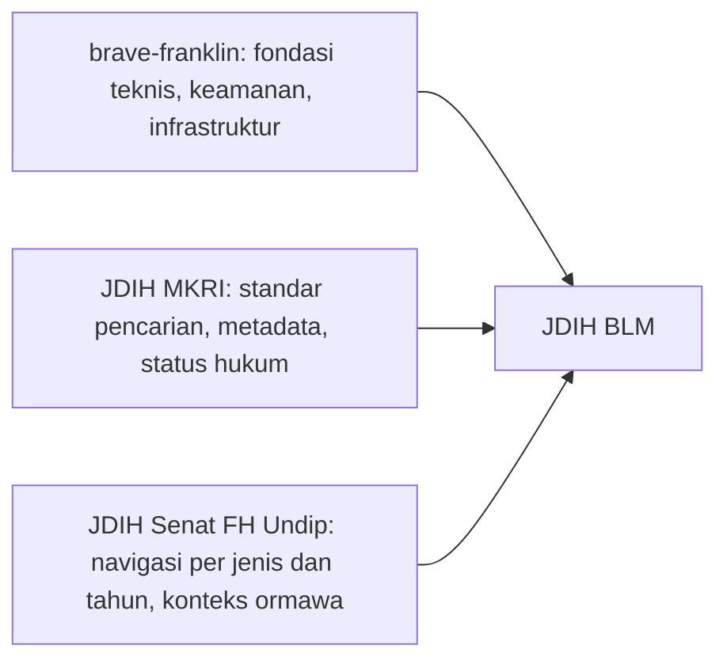
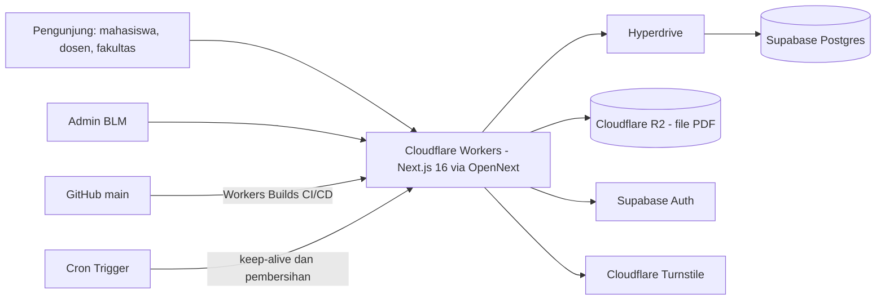
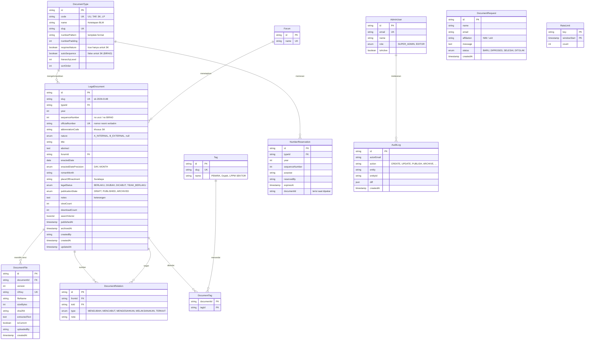
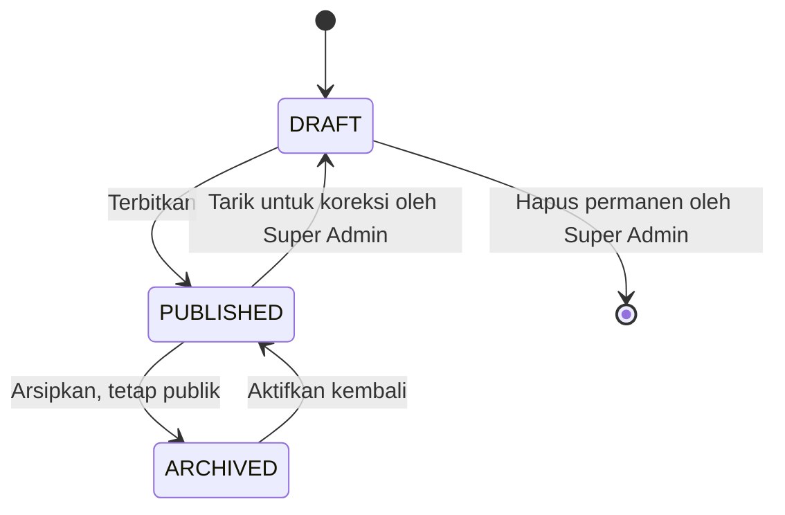
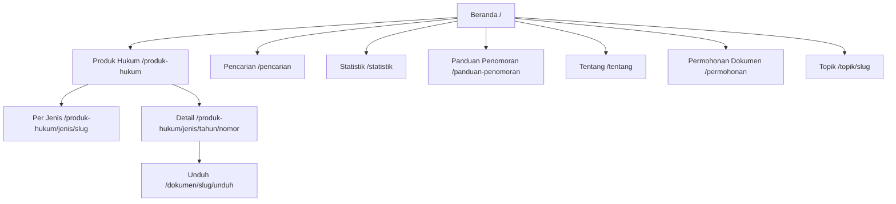
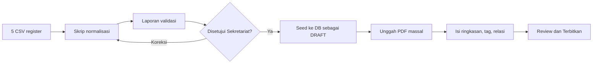

# Implementation Plan — Website JDIH BLM FEB UNAIR

> **JDIH BLM** — Jaringan Dokumentasi dan Informasi Hukum Badan Legislatif Mahasiswa Fakultas Ekonomi dan Bisnis Universitas Airlangga.
> Portal resmi untuk dokumentasi, publikasi, dan pencarian produk hukum BLM: arsip digital terpusat yang transparan, akuntabel, dan mudah diakses.

> [!IMPORTANT]
> Dokumen ini **hanya rencana** (implementation plan). Belum ada kode aplikasi yang dibuat. Bagian [§20 Log Keputusan & Pertanyaan Tersisa](#20-log-keputusan--pertanyaan-tersisa) mencatat keputusan yang telah ditetapkan dan poin yang tersisa.

---

## 0. Ringkasan Eksekutif

| Aspek | Keputusan yang Diusulkan |
|---|---|
| **Fungsi inti** | Katalog, pencarian, pembacaan, dan unduhan produk hukum BLM, plus panel admin untuk menambah, mengedit, menerbitkan, dan mengarsipkan |
| **Data awal** | Register penomoran 2026: **49 entri** (3 TAP, 39 SK, 5 LP, 2 UU). Seluruh 49 entri termasuk SK sifat A (internal) dipublikasikan resmi |
| **Stack** | Mengikuti cetak biru *brave-franklin*: Next.js 16 (App Router) + Tailwind v4 + Cloudflare Workers (OpenNext) + Supabase Postgres via Hyperdrive + Prisma 7. Ditambah **Cloudflare R2** untuk file PDF |
| **Pembeda utama** | Mesin penomoran otomatis sesuai Panduan Penomoran (SK selalu format 4 digit `0000`), relasi antar-produk hukum, status keberlakuan, pencarian teks penuh, dan metadata standar JDIHN |
| **Biaya operasional** | Sekitar Rp0–Rp100 ribu per bulan (tier gratis Cloudflare dan Supabase) + domain |
| **Estimasi** | Sekitar 8 minggu sampai rilis v1.0 (§18) |

---

## 1. Analisis Referensi

### 1.1 `website.md` — Proyek brave-franklin (Jejak Jetis)

Referensi ini relevan untuk **back-end, infrastruktur, dan keamanan**. Domainnya (wisata/booking) berbeda, jadi tidak semua fitur dipakai.

| Elemen brave-franklin | Keputusan | Alasan / Adaptasi untuk JDIH |
|---|---|---|
| Next.js 16 App Router, RSC, TypeScript strict | ✅ **Adopsi** | Halaman katalog dan detail cocok dengan Server Components (SEO bagus, JS klien kecil) |
| Tailwind CSS v4 berbasis token tema, WCAG AA, `prefers-reduced-motion` | ✅ **Adopsi** | Token diisi palet JDIH BLM (§11) |
| Cloudflare Workers via `@opennextjs/cloudflare` | ✅ **Adopsi** | Murah, cepat, dan tim sudah berpengalaman |
| Supabase Postgres + Hyperdrive (Session Pooler port 5432) | ✅ **Adopsi** | Masalah IPv6 Supabase gratis sudah terdokumentasi solusinya |
| Prisma 7 + `@prisma/adapter-pg`, compiler `small` (bundle Worker < 3 MiB) | ✅ **Adopsi** | Batas bundle juga berlaku di sini, jadi jangan masukkan pdf.js ke bundle server |
| RLS Zero-Trust + `REVOKE ALL` dari `anon`/`authenticated` | ✅ **Adopsi** | Semua akses DB lewat server |
| Supabase Auth + allowlist admin + validasi sesi di tiap Server Action | ✅ **Adopsi + kembangkan** | Allowlist dipindah ke tabel `AdminUser` dengan peran (Super Admin / Editor) |
| Audit log (`BookingStatusLog`) | ✅ **Adaptasi** | Menjadi `AuditLog` generik untuk semua perubahan produk hukum, sesuai prinsip akuntabilitas |
| `SELECT … FOR UPDATE` untuk kuota | ✅ **Adaptasi** | Dipakai untuk **penguncian nomor urut produk hukum** supaya dua admin tidak mendapat nomor yang sama |
| Turnstile + honeypot + `RateLimit` berbasis hash IP | ✅ **Adaptasi** | Untuk form *Permohonan Dokumen/Informasi* dan pembatasan unduhan massal |
| Halaman cetak dengan `@media print` | ✅ **Adaptasi** | Cetak *lembar metadata* dan *register produk hukum* tanpa library PDF |
| `keep_vars: true`, secret di dashboard, observability | ✅ **Adopsi** | — |
| Hero carousel sinematik | ❌ **Tidak dipakai** | JDIH butuh fokus ke pencarian. Diganti hero statis dengan kolom pencarian besar |
| Booking, kuota sesi, WhatsApp checkout, UMKM/voucher | ❌ **Tidak dipakai** | Di luar domain JDIH |

> [!WARNING]
> `implementation_plan.md` milik brave-franklin memuat **password database dalam teks biasa**. Untuk proyek JDIH, jangan pernah menulis kredensial di dokumen atau repo. Untuk brave-franklin sendiri, sebaiknya password itu dirotasi.

### 1.2 jdih.mkri.id — Referensi Front-end (standar JDIH lembaga negara)

> [!NOTE]
> Situs ini dilindungi Cloudflare challenge sehingga tidak bisa diambil otomatis. Analisis disusun dari hasil pencarian dan pola umum portal JDIH.

Pola yang diadopsi:
- **Hero dengan kolom pencarian dominan** dan filter jenis peraturan di sebelahnya.
- **Navigasi berdasarkan jenis produk hukum** (PMK, PKMK, Persekjen, Putusan, dan seterusnya). Di JDIH BLM menjadi UU, TAP, SK, dan LP.
- **Filter jenis, tahun, nomor, dan kata kunci** di halaman katalog.
- **Halaman detail bermetadata lengkap** (jenis, nomor, tahun, tanggal penetapan, status, subjek) dengan pratinjau dan unduhan dokumen.
- **Konten pendukung** seperti dokumen pembentukan, kajian, dan landmark decision. Di JDIH BLM ini masuk backlog fase 2: Risalah Sidang, Naskah Akademik, Rancangan.

### 1.3 senatfhundip.my.id/jdih — Referensi Front-end (organisasi mahasiswa sejenis)

Struktur yang terlihat:
- Menu JDIH per jenis: *Konstitusi, Peraturan Mahasiswa, Peraturan Senat Mahasiswa, SOP, Keputusan, Rancangan Peraturan*.
- Halaman per jenis (`/jdih/jenis/1`) **dikelompokkan per tahun** (2025, 2017, 2016) dengan daftar dokumen sederhana.
- Footer menampilkan struktur organisasi (Komisi, Badan) dan alamat.
- Fitur pendamping: Kotak Aspirasi, FAQ, Bank Aspirasi, Peminjaman Ruangan, Ajukan Surat.

Yang diadopsi: URL `/produk-hukum/jenis/[slug]`, pengelompokan per tahun, kategori **Rancangan** (fase 2), dan footer struktur organisasi.
Yang diperbaiki: situs Senat tidak punya pencarian lintas jenis, status keberlakuan, metadata, atau relasi antar-dokumen. Keempatnya menjadi nilai tambah JDIH BLM.

### 1.4 Kesimpulan Pola



---

## 2. Analisis Data Produk Hukum (Folder `Nomor Produk Hukum`)

### 2.1 Inventaris

| Jenis | Kode | Jumlah | Rentang Nomor | Periode |
|---|---|---|---|---|
| Undang-Undang & Amandemen | `UU` | 2 | 01–02 | Agustus 2026 |
| Ketetapan BLM | `TAP` | 3 | 001–003 | April–September 2026 |
| Surat Keputusan Legislasi | `SK` | 39 | Buku BIRAD 0100–0170 (ada celah) | Juli–September 2026 |
| Surat Laporan | `LP` | 5 | 001–005 | Juli–September 2026 |
| **Total** | | **49** | | |

> [!NOTE]
> **Dikonfirmasi Jumlah 49:** Sesuai arahan pengguna, total produk hukum yang dikelola adalah **49 entri**. Seluruh produk hukum dipublikasikan ke portal JDIH, termasuk 17 SK yang bersifat internal (A).

Distribusi per bulan: April 1 · Juli 12 · Agustus 7 · September 29. SK bersifat **A (internal) 17** dan **B (eksternal) 22** — seluruhnya dipublikasikan.

### 2.2 Format Penomoran (dari `PANDUAN & KODE`)

| Jenis | Pola | Contoh |
|---|---|---|
| UU | `[2 digit]/UU/BLMFEBUNAIR/[Bulan Romawi]/[Tahun]` | `01/UU/BLMFEBUNAIR/VIII/2026` |
| TAP | `[3 digit]/TAP/BLM/[Bulan Romawi]/[Tahun]` | `002/TAP/BLM/VII/2026` |
| SK | `[4 digit (0000)]/UN.3.1.4/[A\|B]/[Kode Singkatan]/BLM/[Bulan Romawi]/[Tahun]` | `0148/UN.3.1.4/B/SKKEPENGURUSANSEMENTARA/BLM/IX/2026` |
| LP | `[3 digit]/LP/BLM/[Bulan Romawi]/[Tahun]` *(diturunkan dari data register)* | `004/LP/BLM/IX/2026` |

Sifat SK: **A = Internal** (pleno, tata tertib, agenda, peringatan internal, pengunduran diri) · **B = Eksternal** (kebijakan kemahasiswaan, regulasi pemilihan, pengesahan eksternal). Keduanya berstatus publik.

### 2.3 Temuan Kualitas Data & Tindak Lanjut

| # | Temuan | Lokasi | Keputusan & Penanganan |
|---|---|---|---|
| 1 | Tahun salah ketik **`2926`** | UU No. 02 → `02/…/2926` | **Koreksi ke `2026`** (Dikonfirmasi). DB dipasang `CHECK year BETWEEN 2000 AND 2100`. |
| 2 | Lebar nomor SK di register lama: `100`–`108` (3 digit) vs `0126`+ (4 digit) | SK Juli vs Agustus–September | **Ditetapkan selalu 4 digit (`0000`)**. Nomor lama distandarisasi ke format `0100`–`0108`, nomor asli (3 digit) tetap dicatat di `legacyNumber` agar tetap dapat dicari. |
| 3 | Kode singkatan SK **dipakai ulang** (`SKPLENOI`, `SKTATATERTIB`, dll.) | Banyak baris | Keunikan database ditentukan oleh **(jenis, tahun, nomor urut)** dan nomor resmi utuh, bukan kode singkatan. |
| 4 | Kode singkatan `SKTPEMBERHENTIANANGGOTA` pada SK 0150 | SK 0150 | **Dipertahankan apa adanya** sesuai Buku Departemen Legislasi (Dikonfirmasi). |
| 5 | Presisi tanggal berbeda: ada yang lengkap (`5 September 2026`), ada yang hanya bulan (`Juli 2026`, `April 2026`) | TAP 001, SK 100–108, SK 126–130, UU | Kolom `enactedDatePrecision` (`DAY`/`MONTH`), dan UI menampilkan tanggal sesuai presisi dokumen. |
| 6 | Nama forum tidak seragam: `Pleno BLM`, `Sidang Pleno BLM`, `Sidang Protap` | SK vs TAP/LP | Tabel master `Forum`, dinormalisasi jadi *Sidang Pleno BLM* dan *Sidang Prosedur Tetap (Protap)*. |
| 7 | Celah nomor register (109–125, 131–140, 153–157) dan baris kosong 171–173 | Register SK | Buku Departemen Legislasi dipakai bersama surat non-legislasi; nomor SK diinput manual dengan validasi bentrok. Baris 171–173 ditampung sebagai fitur **Pemesanan Nomor** (§6.3). |
| 8 | Sifat A/B tidak bisa ditebak dari judul | SK | Sifat wajib dipilih admin; seluruhnya dipublikasikan. |
| 9 | LP 001 dan LP 002 berjudul identik | Surat Laporan | Tampilkan nomor dan forum secara jelas; pengelola dapat menambahkan subjudul/ringkasan deskriptif. |
| 10 | Belum ada file PDF di folder | — | Kumpulkan PDF final yang sudah ditandatangani untuk diunggah via Unggah Massal (§14). |

### 2.4 Relasi Antar-Produk Hukum yang Terdeteksi

Register menunjukkan klaster topik yang bisa ditampilkan sebagai **"Produk Hukum Terkait"** dan dijadikan **tag subjek**. Semuanya kandidat dan perlu diverifikasi Sekretariat.

| Klaster / Tag | Produk Hukum |
|---|---|
| **PEMIRA** | UU 01 (UU PEMIRA) ← **diubah oleh** UU 02 · SK 0129 (Pengesahan UU PEMIRA) · SK 0126–0128, 0130 · SK 0151 & 0163 (Rekomendasi Penyelenggara) |
| **Orientasi Studi / Ospek** | TAP 002 · SK 106 · LP 004 · SK 0165 · SK 0166 |
| **LPPM SEKTOR** | LP 003 → TAP 003 · SK 0148 · SK 0161 |
| **Keanggotaan BLM** | LP 001 & 002 · SK 107, 108, 0149, 0150 |
| **Pengawasan HIMA/BEM** | TAP 001 (Protap Pengawasan BEM) · LP 005 · SK 0168, 0169 |
| **Persidangan** | SK Sidang Pleno, Agenda Acara, Tata Tertib |

---

## 3. Ruang Lingkup & Sasaran

### 3.1 Termasuk (v1.0)
1. Portal publik: beranda, katalog dan filter, halaman per jenis, detail produk hukum (pratinjau dan unduh PDF), pencarian teks penuh, statistik, panduan penomoran, tentang BLM, permohonan dokumen.
2. Panel admin: CRUD produk hukum, unggah dan versi PDF, generator nomor, relasi, tag, terbit/draf/arsip, impor CSV, manajemen pengguna, audit log, ekspor register.
3. Migrasi 49 entri register 2026 beserta PDF-nya.
4. SEO (sitemap, JSON-LD `Legislation`), feed RSS, API data terbuka read-only.

### 3.2 Tidak Termasuk (backlog fase 2, §18)
Rancangan peraturan dan konsultasi publik, risalah sidang, kotak aspirasi, berita/pengumuman, OCR otomatis untuk PDF hasil scan, integrasi resmi JDIHN, versi bahasa Inggris.

### 3.3 Indikator Keberhasilan
- Produk hukum mana pun ditemukan dalam **≤ 3 klik** atau **1 pencarian**.
- Lighthouse **≥ 90** (Performance, Accessibility, SEO, Best Practices) di mobile.
- **WCAG 2.2 AA** lolos audit axe tanpa pelanggaran serius.
- Admin bisa menerbitkan produk hukum baru dalam **< 5 menit**.
- 100% dari 49 entri termigrasi dengan metadata valid, dan PDF tersedia untuk semua yang dokumennya ada.

---

## 4. Arsitektur & Tech Stack



| Lapisan | Teknologi | Catatan |
|---|---|---|
| Framework | Next.js 16, App Router, RSC, TypeScript strict | Server Actions untuk mutasi admin |
| Styling | Tailwind CSS v4 (`@theme` tokens) | §11 |
| Hosting | Cloudflare Workers + `@opennextjs/cloudflare` | Cache inkremental/ISR via R2 atau KV (konfigurasi OpenNext) |
| Database | Supabase Postgres + Hyperdrive (Session Pooler 5432) | Ekstensi `pg_trgm`, `unaccent` |
| ORM | Prisma 7 + `@prisma/adapter-pg`, compiler `small` | Migrasi SQL manual untuk tsvector/trigram/CHECK |
| Penyimpanan file | **Cloudflare R2** (bucket privat, binding `DOCS_BUCKET`) | Gratis 10 GB, tanpa biaya egress. File disajikan lewat route Worker |
| Auth | Supabase Auth (email + password / magic link) + tabel `AdminUser` | Peran: `SUPER_ADMIN`, `EDITOR` |
| Validasi | Zod 4 (shared client/server) | — |
| Anti-bot | Turnstile + honeypot + `RateLimit` | Form permohonan dokumen |
| Analitik | Cloudflare Web Analytics | Tanpa cookie, ramah privasi |
| Testing | Vitest (unit), Playwright (e2e), axe-core (a11y) | §16 |

> [!TIP]
> **PDF tidak diproses di Worker.** Batas CPU dan bundle Worker terlalu ketat untuk parsing PDF. Ekstraksi teks (untuk pencarian isi) dilakukan **di browser admin** saat unggah memakai `pdfjs-dist` yang di-*dynamic import*, lalu teksnya dikirim ke server.

---

## 5. Model Data

### 5.1 ERD



### 5.2 Dua Sumbu Status (penting dan sering tertukar)

| Sumbu | Nilai | Arti | Terlihat publik? |
|---|---|---|---|
| **`legalStatus`** (status hukum) | `BERLAKU`, `DIUBAH` (berlaku dengan perubahan), `DICABUT`, `TIDAK_BERLAKU` | Keberlakuan hukum dokumen | **Ya, semua**, ditampilkan sebagai badge |
| **`publicationState`** (status publikasi) | `DRAFT`, `PUBLISHED`, `ARCHIVED` | Pengelolaan konten di website | `PUBLISHED` dan `ARCHIVED` **tampil**. Hanya `DRAFT` yang tersembunyi |

> [!IMPORTANT]
> **Keputusan:** semua produk hukum dipublikasikan, termasuk SK sifat A (internal). Produk hukum yang **dicabut, diubah, tidak berlaku, atau diarsipkan tetap ditampilkan** ke publik dengan badge statusnya demi transparansi sejarah hukum.
> - **Diarsipkan** (`ARCHIVED`) berarti dokumen historis atau tidak aktif (mis. SK sidang yang sudah selesai dilaksanakan, atau produk periode kepengurusan lalu). Dokumen tetap bisa dicari, dibaca, dan diunduh, dengan badge "Diarsipkan".
> - **Draf** (`DRAFT`) hanya untuk dokumen yang belum selesai diinput, atau ditarik sementara oleh Super Admin untuk koreksi salah unggah. Hanya status ini yang tidak terlihat publik.



Aturan otomatis: membuat relasi `MENGUBAH` dari A ke B akan menyetel `B.legalStatus = DIUBAH`. Relasi `MENCABUT` menyetel `DICABUT`. Keduanya dicatat di `AuditLog`.

### 5.3 Integritas Data (CHECK & Index)
- `UNIQUE (typeId, year, sequenceNumber)` dan `UNIQUE (officialNumber)`.
- `CHECK (year BETWEEN 2000 AND 2100)` untuk mencegah salah ketik seperti `2926`.
- `CHECK (sequenceNumber > 0)`.
- `CHECK (nature IS NULL OR abbreviationCode IS NOT NULL)`. Aturan "nature wajib untuk SK" divalidasi di Zod dan trigger.
- `CHECK (fromId <> toId)` pada `DocumentRelation`, `UNIQUE (fromId, toId, type)`.
- Index: GIN `searchVector`; GIN trigram pada `title` dan `officialNumber`; B-tree `(publicationState, typeId, year DESC)`.
- RLS aktif di semua tabel tanpa policy untuk `anon`/`authenticated` + `REVOKE ALL` (pola brave-franklin).

---

## 6. Mesin Penomoran

Modul murni `src/lib/numbering.ts` tanpa dependensi DB sehingga mudah diuji.

### 6.1 Fungsi
- `toRoman(month)` / `fromRoman(str)`.
- `formatOfficialNumber(type, { seq, month, year, nature?, code? })` menghasilkan string sesuai §2.2.
- `parseOfficialNumber(str)` mengurai kembali ke komponen. Dipakai untuk **validasi impor** dan **pencarian cerdas** (mis. kueri `TAP/BLM/IX` atau `0148`).
- `suggestAbbreviationCode(title)` mengusulkan kode SK dari judul (huruf kapital, tanpa spasi). Tetap bisa diedit.

### 6.2 Alur di Form Admin
1. Admin memilih **jenis** dan **tanggal penetapan**. Bulan Romawi dan tahun terisi otomatis.
2. Untuk **UU/TAP/LP**, nomor urut berikutnya diusulkan otomatis dari `MAX(sequenceNumber)` per jenis per tahun (perlu dikonfirmasi apakah nomor direset tiap tahun).
3. Untuk **SK**, admin mengisi **No Buku Departemen Legislasi** secara manual (karena buku dipakai bersama surat lain). Nomor **selalu diformat 4 digit** (`171` → `0171`). Kode singkatan diisi persis seperti di Buku Departemen Legislasi. Sistem menampilkan nomor terakhir yang terpakai dan memperingatkan bila bentrok.
4. Pratinjau nomor resmi tampil *live*. Override hanya untuk Super Admin, dan setiap override dicatat di audit log.
5. Saat simpan, transaksi dengan `SELECT … FOR UPDATE` pada baris counter memastikan tidak ada duplikat ketika dua admin menyimpan bersamaan.

### 6.3 Pemesanan Nomor (Number Reservation)
Register lama menyisakan baris kosong (BIRAD 171–173) untuk sidang yang akan datang. Fitur ini mendigitalkannya: admin memesan nomor sebelum sidang, nomor terkunci sampai dipakai atau kedaluwarsa, lalu otomatis tertaut ke dokumen saat dibuat.

---

## 7. Pencarian

| Lapisan | Implementasi |
|---|---|
| **Teks penuh** | `tsvector` (konfigurasi `simple` + `unaccent`, karena Postgres tidak punya kamus Indonesia) dengan bobot: judul & nomor **A**, ringkasan & tag **B**, isi PDF **C** |
| **Toleransi salah ketik** | `pg_trgm` similarity pada judul (mis. "pemira" / "pemirra") |
| **Pencarian nomor** | Bila kueri cocok pola nomor (`/TAP/`, `UN.3.1.4`, angka 2–4 digit), lakukan pencarian prefix/ILIKE pada `officialNumber` lebih dulu |
| **Filter** | Jenis, tahun, bulan, status hukum, sifat (A/B), forum, tag |
| **Urutan** | Relevansi (default saat ada kueri), terbaru, terlama, nomor, paling banyak dilihat |
| **UX** | Kueri tersimpan di URL (`?q=&jenis=&tahun=`) sehingga bisa dibagikan, highlight kata kunci (`ts_headline`), saran "Mungkin maksud Anda…", empty state dengan tautan ke permohonan dokumen |

---

## 8. Manajemen Dokumen & File

- **Unggah:** hanya PDF (cek *magic bytes* `%PDF`), maks. 20 MB, hash SHA-256 untuk deteksi duplikat.
- **Kunci R2:** `produk-hukum/{jenis}/{tahun}/{slug}/v{n}.pdf`.
- **Versi:** unggahan baru tidak menimpa file lama. Versi sebelumnya tetap tersimpan, dengan satu versi `isCurrent`.
- **Penyajian:** `GET /dokumen/[slug]/unduh` dan `/dokumen/[slug]/lihat` diproses Worker: cek status publikasi bukan `DRAFT`, naikkan `downloadCount` (dibatasi rate limit agar tidak dimanipulasi), set `Content-Disposition` dengan nama file rapi (mis. `TAP-BLM-002-2026-Kebijakan-Orientasi-Studi.pdf`), dan cache di edge.
- **Draf:** file tidak dapat diakses publik (404). Dokumen **diarsipkan** dan **dicabut** tetap bisa dibaca dan diunduh.
- **Pratinjau di mobile:** Chrome Android tidak merender PDF di `<iframe>`. Desktop memakai viewer bawaan browser, sedangkan mobile menampilkan tombol "Buka PDF" + viewer `pdfjs-dist` yang dimuat *lazy* di klien.

---

## 9. Arsitektur Informasi & Halaman Publik

### 9.1 Peta Situs



Permalink detail dibuat mudah dibaca dan stabil: `/produk-hukum/tap/2026/002`, `/produk-hukum/sk/2026/0148`, `/produk-hukum/uu/2026/01`.

### 9.2 Spesifikasi Halaman

**Beranda `/`**
1. Header: logo BLM + "JDIH BLM FEB UNAIR", navigasi (Beranda, Produk Hukum ▾ per jenis, Statistik, Panduan, Tentang), tombol pencarian.
2. Hero (latar `--color-dark` dengan motif garis emas tipis): judul, subjudul misi transparansi, **kolom pencarian besar** + dropdown jenis + contoh kueri ("PEMIRA", "Tata Tertib", "002/TAP").
3. **Kartu jenis produk hukum** (UU, TAP, SK, LP) dengan ikon, jumlah dokumen, dan tautan.
4. **Statistik ringkas** (counter): total produk hukum, berlaku, diterbitkan tahun ini, total unduhan.
5. **Produk hukum terbaru** (6 kartu) dan **paling banyak dilihat**.
6. **Topik populer** (chip tag: PEMIRA, Ospek, LPPM SEKTOR…).
7. **Hierarki produk hukum BLM** (UU → TAP → SK → LP) sebagai visual edukatif.
8. Footer: alamat FEB UNAIR, struktur BLM (Komisi/Badan), tautan cepat, media sosial, kontak.

**Katalog `/produk-hukum`**
- Sidebar filter (desktop), *bottom sheet* (mobile), dan chip filter aktif yang bisa dihapus.
- Toggle tampilan **Kartu / Tabel** (tabel mirip register: Nomor | Judul | Jenis | Tanggal | Status).
- Paginasi berbasis URL (20 per halaman) dan jumlah hasil.
- Semua produk hukum (berlaku, diubah, dicabut, tidak berlaku, diarsipkan) **tampil secara default** dengan badge statusnya. Filter status memungkinkan pengguna mempersempit, mis. "Hanya yang berlaku".

**Per Jenis `/produk-hukum/jenis/[slug]`** (pola Senat FH Undip)
- Deskripsi jenis dan format nomornya.
- Daftar **dikelompokkan per tahun** (accordion, tahun terbaru terbuka), dengan filter cepat.

**Detail `/produk-hukum/[jenis]/[tahun]/[nomor]`**
- Kolom utama: breadcrumb → badge jenis + status → **judul** → nomor resmi (font mono, tombol salin) → ringkasan → **pratinjau PDF**.
- Sidebar *sticky*, **tabel metadata** (selaras metadata JDIHN): Jenis, Nomor, Tahun, Judul/Tentang, Sifat (SK), Forum Penetapan, Tempat & Tanggal Penetapan, Status, Subjek/Tag, Bahasa, Lokasi (BLM FEB UNAIR), Lampiran.
- Aksi: **Unduh PDF**, Salin nomor, **Salin sitasi**, Bagikan (WhatsApp/salin tautan), Cetak lembar metadata.
- Bagian **Status & Relasi**: "Mengubah…", "Diubah oleh…", "Dicabut oleh…", "Dasar pelaksanaan…".
- **Produk hukum terkait** (tag yang sama) dan **riwayat versi file**.
- Banner peringatan bila status `DICABUT`/`DIUBAH` dengan tautan ke dokumen penggantinya, serta banner netral "Dokumen ini telah diarsipkan" untuk `ARCHIVED`. Dokumen tetap bisa dibaca dan diunduh.

Contoh sitasi:
> Ketetapan BLM FEB UNAIR Nomor 002/TAP/BLM/VII/2026 tentang Kebijakan Orientasi Studi dan Pengenalan Kampus di Lingkungan FEB UNAIR, ditetapkan di Surabaya pada 28 Juli 2026.

**Halaman lain**
- `/pencarian`: hasil dengan highlight dan filter yang sama dengan katalog.
- `/statistik`: grafik per jenis, per bulan, status, dan sifat SK (SVG/CSS ringan, tanpa library chart berat).
- `/panduan-penomoran`: penjelasan format nomor dan kode A/B, untuk transparansi publik.
- `/tentang`: profil BLM, visi-misi JDIH, struktur, dasar hukum pembentukan JDIH BLM, kontak pengelola.
- `/permohonan`: form permohonan dokumen/informasi yang belum tersedia (Turnstile + honeypot + rate limit).
- `/topik/[slug]`: semua produk hukum dengan tag tertentu.
- Teknis: `/sitemap.xml`, `/robots.txt`, `/feed.xml` (RSS produk hukum terbaru), `/api/v1/produk-hukum` (JSON data terbuka read-only, `PUBLISHED` + `ARCHIVED`, tanpa draf), halaman 404/500 yang informatif.

---

## 10. Panel Admin (`/admin`)

| Halaman | Fitur |
|---|---|
| **Login** | Supabase Auth. Akun harus ada di `AdminUser` dan aktif |
| **Dasbor** | Ringkasan jumlah per jenis/status, **peringatan kualitas data** (dokumen tanpa PDF, tanpa ringkasan, tanggal presisi bulan), aktivitas terakhir, permohonan baru |
| **Produk Hukum** | Tabel dengan pencarian/filter, aksi massal (terbitkan, arsipkan), indikator file |
| **Form Produk Hukum** | Field metadata + generator nomor live (§6), unggah PDF *drag-and-drop* + ekstraksi teks di browser, pemilih relasi (autocomplete), tag, pratinjau tampilan publik, Simpan Draf / Terbitkan |
| **Impor CSV** | Unggah CSV format register SPSS → pratinjau → **laporan validasi** (temuan §2.3 ditandai merah/kuning) → konfirmasi impor |
| **Unggah PDF Massal** | Pencocokan otomatis nama file ke dokumen (mis. `TAP-002-2026.pdf`), dengan konfirmasi |
| **Pemesanan Nomor** | Pesan, lepas, dan lihat nomor yang dipesan |
| **Master Data** | Jenis produk hukum, forum, tag (khusus Super Admin) |
| **Permohonan** | Kotak masuk permohonan dokumen beserta perubahan status |
| **Pengguna** | Tambah/nonaktifkan admin, atur peran (khusus Super Admin) |
| **Audit Log** | Riwayat siapa mengubah apa dan kapan (diff sebelum/sesudah), filter per dokumen/pengguna |
| **Ekspor** | Register ke CSV/Excel dengan kolom yang sama seperti spreadsheet SPSS, plus halaman cetak register (`@media print`) |

Admin awal: **`puguhmuqoddam151@gmail.com`** sebagai **Super Admin**, dibuat lewat seed dan env `SUPER_ADMIN_EMAILS`. Editor lain bisa ditambahkan dari halaman Pengguna.

Matriks peran:

| Aksi | Editor | Super Admin |
|---|---|---|
| Buat/edit draf, unggah file | ✅ | ✅ |
| Terbitkan, arsipkan, ubah status hukum | ✅ | ✅ |
| Tarik dokumen terbit ke Draf (koreksi salah unggah) | ❌ | ✅ |
| Hapus permanen (hanya Draf) | ❌ | ✅ |
| Master data, pengguna, impor CSV | ❌ | ✅ |

---

## 11. Design System

### 11.1 Palet & Analisis Kontras (WCAG 2.2)

| Token | Hex | Kontras vs `#FFFDF7` | Penggunaan yang Diizinkan |
|---|---|---|---|
| `--color-primary` | `#d4af38` | **2,1 : 1** ❌ teks | **Hanya** isian tombol (dengan teks `dark`), garis aksen, ikon dekoratif, highlight, dan teks **di atas latar gelap** |
| `--color-secondary` | `#b96d41` | **3,9 : 1** ⚠️ | Teks besar/tebal (≥ 18,66 px bold), badge, ikon. Untuk teks normal pakai varian `secondary-strong` |
| `--color-dark` | `#3E2C1C` | **13,0 : 1** ✅ AAA | Teks utama, header/footer gelap, hero |
| `--color-background` | `#FFFDF7` | — | Latar halaman |
| `--color-accent` | `#80691d` | **5,2 : 1** ✅ AA | Tautan, teks sekunder berwarna, ring fokus di latar terang |

Kombinasi kunci yang sudah dihitung:
- Teks `dark` di atas tombol `primary`: **6,3 : 1** ✅. Ini gaya tombol utama.
- Teks `primary` di atas latar `dark`: **6,3 : 1** ✅. Untuk header, footer, dan hero.
- Teks putih di atas `accent`: **5,3 : 1** ✅. Untuk tombol sekunder.

> [!WARNING]
> Kesalahan paling mudah terjadi adalah menulis teks emas (`#d4af38`) di atas latar krem, karena kontrasnya hanya 2,1:1 dan tidak terbaca. Lint aturan ini di code review.

### 11.2 Token (Tailwind v4)

```css
@theme {
  /* Palet brand (dari brief) */
  --color-primary: #d4af38;
  --color-secondary: #b96d41;
  --color-dark: #3E2C1C;
  --color-background: #FFFDF7;
  --color-accent: #80691d;

  /* Turunan (diverifikasi >= 4.5:1 pada background) */
  --color-secondary-strong: #96552f; /* ~5.7:1, teks terakota */
  --color-muted: #6B5A48;            /* ~6.5:1, teks sekunder/metadata */
  --color-surface: #FFFFFF;
  --color-surface-muted: #F7F1E3;    /* latar kartu/sidebar */
  --color-border: #E8DEC4;

  /* Semantik status hukum (nilai final diverifikasi kontrasnya saat implementasi) */
  --color-status-berlaku: #2E6B3F;
  --color-status-diubah: #96552f;
  --color-status-dicabut: #A23B2A;
  --color-status-tidak-berlaku: #6B5A48;

  --font-serif: "Source Serif 4", Georgia, serif;     /* judul: kesan formal/hukum */
  --font-sans: "Plus Jakarta Sans", system-ui, sans-serif; /* teks isi */
  --font-mono: "JetBrains Mono", ui-monospace, monospace;  /* nomor produk hukum */
}
```

Font di-*self-host* via `next/font` (tanpa request ke Google, lebih cepat dan privat).

### 11.3 Prinsip Visual
- **Profesional dan tenang:** banyak ruang putih, grid 12 kolom, lebar baca maksimal ~72 karakter untuk teks.
- **Identitas:** aksen garis emas tipis, motif geometris halus (opsional terinspirasi ornamen Airlangga) pada hero dan footer, dan logo BLM.
- **Nomor produk hukum selalu mono** agar mudah dipindai dan disalin.
- **Badge jenis** dengan warna konsisten (UU = dark, TAP = accent, SK = secondary-strong, LP = muted) dan **badge status** dengan ikon + teks (tidak hanya warna).
- **Gerak minimal:** transisi 150–200 ms, nonaktif di `prefers-reduced-motion`.

### 11.4 Komponen Inti
`SiteHeader`, `SiteFooter`, `SearchBar` (dengan saran), `DocTypeCard`, `DocumentCard`, `DocumentTable`, `FilterPanel` / `FilterSheet`, `ActiveFilterChips`, `StatusBadge`, `TypeBadge`, `MetadataTable`, `PdfViewer`, `RelationList`, `CopyButton`, `CitationBox`, `YearAccordion`, `StatCounter`, `Breadcrumbs`, `Pagination`, `EmptyState`, `Toast`. Komponen admin: `DocumentForm`, `NumberPreview`, `FileDropzone`, `RelationPicker`, `ImportReport`, `AuditDiff`.

---

## 12. Keamanan & Privasi

1. **Zero-Trust DB:** RLS + `REVOKE ALL` (pola brave-franklin). Hanya server yang memegang kredensial.
2. **Otorisasi berlapis:** middleware untuk `/admin/*`, lalu setiap Server Action memvalidasi sesi + peran (bukan hanya di UI).
3. **Validasi input:** Zod di semua Server Action. Upload dicek tipe, ukuran, magic bytes, dan nama file disanitasi.
4. **R2 privat:** tanpa URL publik langsung. File dilayani lewat Worker yang mengecek status publikasi. Hanya `DRAFT` yang diblokir, sedangkan dokumen diarsipkan atau dicabut tetap bisa diunduh.
5. **Anti-spam:** Turnstile + honeypot + rate limit (mis. 3 permohonan / 10 menit / IP; unduhan dihitung maks. 1x per IP per dokumen per jam).
6. **Header keamanan:** CSP ketat, `X-Content-Type-Options`, `Referrer-Policy`, `frame-ancestors 'self'`.
7. **Secret** hanya di Cloudflare Dashboard (`keep_vars: true`): `SUPABASE_URL`, `SUPABASE_ANON_KEY`, `SUPER_ADMIN_EMAILS` (bootstrap, berisi `puguhmuqoddam151@gmail.com`), `SITE_URL`, `TURNSTILE_SITE_KEY`, `TURNSTILE_SECRET_KEY`, `IP_HASH_SALT`. Binding `HYPERDRIVE` dan `DOCS_BUCKET` di `wrangler.jsonc`.
8. **Privasi:** IP hanya disimpan sebagai hash bergaram. Data pemohon hanya terlihat admin. Analitik tanpa cookie.
9. **Integritas arsip:** hash SHA-256 file disimpan dan bisa ditampilkan di halaman detail sebagai bukti keaslian dokumen.

---

## 13. SEO, Performa & Aksesibilitas

| Area | Target / Implementasi |
|---|---|
| SEO | `generateMetadata` per halaman, OG image dinamis per dokumen (jenis + nomor + judul), JSON-LD schema.org **`Legislation`** (`legislationIdentifier`, `legislationDate`, `legislationType`, `legislationLegalForce`), sitemap otomatis, canonical URL |
| Performa | LCP < 2,5 s di 4G, JS publik < 150 KB gzip, halaman publik di-cache dan di-*revalidate* via `revalidateTag` saat admin menyimpan, gambar `.webp`/`next/image` |
| Bundle Worker | < 3 MiB (free tier). pdf.js hanya di klien (dynamic import), tanpa library chart berat |
| Aksesibilitas | WCAG 2.2 AA: skip link, landmark semantik, navigasi keyboard penuh, fokus terlihat (ring accent/primary), label form eksplisit, tabel dengan `<caption>`/`scope`, `aria-live` untuk hasil pencarian, target sentuh ≥ 24 px, `lang="id"` |
| Responsif | Mobile-first. Breakpoint utama: 640 / 768 / 1024 / 1280 |
| Cetak | `@media print` untuk lembar metadata dan register |

---

## 14. Migrasi 49 Produk Hukum



1. **Normalisasi** (`prisma/seed/import-register.ts`): baca 5 CSV, lewati baris judul dan baris kosong (SK 171–173 menjadi `NumberReservation`), petakan forum, parse tanggal dan presisi, dan jalankan `parseOfficialNumber` untuk memastikan nomor cocok dengan komponen (bulan Romawi = bulan tanggal, tahun = tahun). Koreksi yang sudah disetujui diterapkan otomatis:
   - UU 02: `…/VIII/2926` → `02/UU/BLMFEBUNAIR/VIII/2026`.
   - SK 100–108 dinormalisasi ke 4 digit (`0100`–`0108`), dan nomor asli disimpan di `legacyNumber`.
   - Kode singkatan SK dipertahankan **persis sesuai Buku Departemen Legislasi** (termasuk `SKTPEMBERHENTIANANGGOTA`).
2. **Laporan validasi** berisi temuan §2.3 yang tersisa (presisi tanggal, forum, judul LP identik) untuk ditinjau sebelum seed.
3. **Seed** ke-49 entri sebagai `DRAFT` dengan tag dan relasi kandidat dari §2.4. Semua jenis, **termasuk SK sifat A (internal)**, akan diterbitkan.
4. **PDF**: Sekretariat mengumpulkan PDF final yang sudah ditandatangani dengan konvensi nama `{JENIS}-{NOMOR}-{TAHUN}.pdf`, lalu diunggah lewat fitur unggah massal.
5. **Pengayaan**: ringkasan 1–3 kalimat per dokumen (bisa dicicil, prioritas UU, TAP, dan LP).
6. **Review dan terbitkan** per jenis.

> [!TIP]
> Skrip impor yang sama dipakai ulang lewat **Impor CSV** di admin, sehingga register tahun berikutnya bisa dimasukkan sekaligus.

---

## 15. Struktur Proyek yang Diusulkan

```
jdih-blm/
├─ prisma/
│  ├─ schema.prisma
│  ├─ migrations/                 # termasuk SQL manual: tsvector, trigram, CHECK, RLS
│  └─ seed/
│     ├─ data/*.csv               # salinan register 2026
│     └─ import-register.ts
├─ src/
│  ├─ app/
│  │  ├─ (public)/
│  │  │  ├─ page.tsx              # Beranda
│  │  │  ├─ produk-hukum/
│  │  │  │  ├─ page.tsx           # Katalog
│  │  │  │  ├─ jenis/[slug]/page.tsx
│  │  │  │  └─ [jenis]/[tahun]/[nomor]/page.tsx
│  │  │  ├─ pencarian/  statistik/  panduan-penomoran/
│  │  │  ├─ tentang/  permohonan/  topik/[slug]/
│  │  ├─ admin/                   # login, dasbor, produk, impor, nomor, master, pengguna, audit
│  │  ├─ dokumen/[slug]/(unduh|lihat)/route.ts
│  │  ├─ api/v1/produk-hukum/route.ts
│  │  ├─ feed.xml/route.ts  sitemap.ts  robots.ts
│  │  └─ globals.css              # @theme tokens
│  ├─ components/{ui,public,admin}/
│  ├─ lib/
│  │  ├─ numbering.ts  search.ts  storage-r2.ts
│  │  ├─ auth.ts  audit.ts  rate-limit.ts  turnstile.ts
│  │  ├─ validation/*.ts          # skema Zod
│  │  └─ db.ts
│  └─ middleware.ts
├─ tests/{unit,e2e}/
├─ wrangler.jsonc  open-next.config.ts
├─ README.md  DEPLOY.md  PANDUAN-ADMIN.md
```

---

## 16. Rencana Pengujian & Verifikasi

| Jenis | Cakupan |
|---|---|
| **Unit (Vitest)** | `numbering.ts`: format dan parse *round-trip* untuk **ke-49 nomor di register** (setelah koreksi `2026` dan normalisasi SK 4 digit), Romawi I–XII, padding 4 digit SK (`100` → `0100`). Skema Zod. Logika status otomatis dari relasi |
| **Integrasi** | Impor CSV menghasilkan **49 dokumen** + 3 reservasi (BIRAD 171–173) dan anomali terlaporkan. Transaksi nomor paralel tidak menghasilkan duplikat. Query pencarian ("PEMIRA" harus mengembalikan UU 01, UU 02, SK 0126–0130, 0151, 0163; kueri `100/UN.3.1.4` tetap menemukan SK 0100 via `legacyNumber`) |
| **E2E (Playwright)** | Cari → filter → buka detail → unduh. Admin: login → buat TAP baru → nomor `004/TAP/BLM/…` terisi → buat SK baru → nomor `0171/UN.3.1.4/…` → unggah PDF → terbitkan → tampil di publik → **arsipkan → tetap tampil dengan badge "Diarsipkan"** → tandai dicabut → tetap tampil dengan badge "Dicabut" + tautan pencabut. Draf tidak tampil dan URL filenya 404 |
| **Keamanan** | Role `anon` tidak bisa `SELECT` tabel mana pun. Server Action admin menolak tanpa sesi atau email di luar `AdminUser`. Peran Editor ditolak untuk aksi Super Admin. File draf tidak bisa diakses |
| **Aksesibilitas** | axe-core di semua template halaman + uji keyboard manual + pembaca layar (NVDA) di halaman detail |
| **Performa** | Lighthouse CI di beranda, katalog, dan detail (≥ 90). Cek ukuran bundle Worker di CI |
| **UAT** | 2–3 anggota BLM (admin) + 3–5 mahasiswa (pengguna) menjalankan skenario tugas nyata |

---

## 17. Deployment, Operasional & Pencadangan

- **CI/CD:** GitHub → Cloudflare Workers Builds (branch `main` = produksi, branch lain = preview). Typecheck, lint, dan test wajib lolos.
- **Domain:** Menggunakan subdomain gratis resmi Cloudflare **`*.workers.dev`** (misal: `jdih-blmfebunair.workers.dev` atau `jdih-blm.workers.dev`). Tanpa biaya sewa domain. Di masa mendatang, BLM dapat mengajukan CNAME subdomain kampus resmi (misal: `jdih-blm.feb.unair.ac.id`) bila disetujui pihak fakultas/universitas.
- **Keep-alive Supabase:** proyek Supabase gratis **dijeda setelah ~7 hari tanpa aktivitas**, padahal situs arsip bisa sepi trafik. Cron Trigger Cloudflare harian menjalankan query ringan sekaligus membersihkan `RateLimit` dan reservasi kedaluwarsa.
- **Backup** (kritis untuk arsip hukum): `pg_dump` mingguan via GitHub Actions ke bucket R2 terpisah, dengan retensi 12 minggu. R2 file utama tidak pernah dihapus permanen (versi lama disimpan). Uji restore tiap semester.
- **Monitoring:** Cloudflare Observability (error, CPU time) dan notifikasi email untuk permohonan baru.
- **Serah terima:** `PANDUAN-ADMIN.md` (cara unggah, menomori, mengarsipkan), pelatihan 1 sesi untuk pengurus, dan **SOP pergantian kepengurusan** (transfer akun Super Admin dan rotasi secret) agar website tidak terbengkalai saat periode berganti.

---

## 18. Roadmap, Timeline & Strategi Model AI (Quota-Guarded)

### 18.1 Analisis & Strategi Limit Kuota AI (5-Hour & Weekly Limit Guard)

> [!TIP]
> **Kebijakan Penghematan Limit Kuota Claude Opus 5.5 (High):**  
> Opus 5.5 memiliki batas pesan per jendela 5 jam (*rolling limit*) serta kuota mingguan yang ketat. Jika Opus dipakai untuk tugas umum seperti *install package*, membuat boilerplate, atau menjalankan perintah terminal biasa, kuota 5 jam akan cepat habis.  
> **Aturan Utama:**
> 1. **Gemini 3.8 Flash (High)** memegang **~80% beban kerja**: seluruh setup awal (*scaffolding*), instalasi, styling CSS, slicing antarmuka publik, form admin, penulisan unit test runner, dan eksekusi terminal.
> 2. **Claude Opus 5.5 (High)** dikhususkan hanya untuk **~20% tugas kritis berdaya nalar tinggi** dalam bentuk **Mikro-Sprint (1–2 prompt per sesi)**. Dengan cara ini, satu sesi Opus hanya memakan 1–2 pesan sehingga kuota 5 jam dan kuota mingguan tetap sangat aman.

---

### 18.2 Matriks Pembagian Kerja & Pemecahan Mikro-Sprint

Untuk menjamin penggunaan kuota tidak melebihi batas 5 jam, tahapan kerja dipecah menjadi unit-unit mikro berikut:

```mermaid
flowchart TD
    subgraph Tahap 1: Fondasi
        T1A["1A: Scaffolding & Setup (Flash)"] --> T1B["1B: Prisma Schema & RLS SQL (Opus Sprint 1)"]
        T1B --> T1C["1C: Algoritma numbering.ts (Opus Sprint 2)"]
        T1C --> T1D["1D: Vitest Runner & Test Suite (Flash)"]
    end
    subgraph Tahap 2: UI Publik
        T2["Tahap 2: Slicing UI Publik (Flash 100%)"]
    end
    subgraph Tahap 3: Panel Admin & Storage
        T3B1["3B: Slicing Form & UI Admin (Flash)"] --> T3A1["3A.1: Auth Guard & Concurrency Lock (Opus Sprint 3)"]
        T3A1 --> T3A2["3A.2: R2 Stream Route (Opus Sprint 4)"]
    end
    subgraph Tahap 4: Migrasi
        T4["Tahap 4: Migrasi 49 Data & Form Publik (Flash 100%)"]
    end
    subgraph Tahap 5: Deployment
        T5A["5A: Typecheck & Build Standar (Flash)"] -.->|Hanya jika error bundler| T5B["5B: Deep Debugging OpenNext (Opus Sprint 5)"]
    end
```



#### Rincian Mikro-Sprint Opus 5.5 High (Maksimal 1–2 Prompt per Sprint):
* **Opus Sprint 1 (~10–15 menit, 1 prompt):**  
  *Fokus:* Merancang file `prisma/schema.prisma` final dan berkas DDL SQL manual (`01_init_hardening.sql`) berisi RLS Zero-Trust, ekstensi `pg_trgm`, `unaccent`, index `searchVector`, dan CHECK constraints.
* **Opus Sprint 2 (~10–15 menit, 1 prompt):**  
  *Fokus:* Menulis modul murni `src/lib/numbering.ts` (fungsi generator, parser regex, angka Romawi, padding 4-digit `0000`, dan deteksi sifat A/B) tanpa dependensi eksternal.
* **Opus Sprint 3 (~10–15 menit, 1 prompt):**  
  *Fokus:* Menulis Server Action Auth Guard (validasi izin `puguhmuqoddam151@gmail.com`) dan transaksi database `SELECT ... FOR UPDATE` untuk kunci counter penomoran.
* **Opus Sprint 4 (~10–15 menit, 1 prompt):**  
  *Fokus:* Mengonfigurasi Cloudflare R2 binding dan endpoint route streaming berkas `/dokumen/[slug]/unduh` & `/lihat` dengan validasi status publikasi.
* **Opus Sprint 5 (Opsional / Fallback, 1 prompt):**  
  *Fokus:* Hanya dipanggil jika terjadi error kompilasi `@opennextjs/cloudflare` atau masalah bundle size > 3 MiB yang gagal diselesaikan oleh Flash.

#### Rincian Tugas Gemini 3.8 Flash High (Beban Kerja Utama):
* **Tahap 1A & 1D:** Inisialisasi Next.js 16, dependensi, konfigurasi Tailwind v4 token `#d4af38`, template `.env`, penyiapan Vitest, dan eksekusi test runner.
* **Tahap 2 (Portal Publik):** Pembuatan layout publik, Beranda, Katalog, Filter Sheet, Detail Dokumen, Metadata Table, pencarian front-end, dan halaman statis.
* **Tahap 3B (UI Admin):** Dashboard `/admin`, form metadata produk hukum, live number preview, dropzone PDF dengan browser text extractor (`pdfjs-dist`), form impor CSV, dan antarmuka tiket permohonan.
* **Tahap 4 (Data & Form):** Skrip import 49 entri register 2026, seeding database, form permohonan dokumen pengunjung, widget Turnstile, dan RSS feed.
* **Tahap 5A (Build & Deploy):** Menjalankan `npm run typecheck`, `npm run lint`, `npx open-next build`, dan memicu deploy ke `*.workers.dev`.

---

### 18.3 Roadmap & Timeline Mingguan

| Fase | Durasi | Keluaran | Alokasi Model AI |
|---|---|---|---|
| **0. Persiapan** | Minggu 1 | Konfirmasi keputusan, struktur repo, akun Cloudflare/Supabase | Gemini Flash |
| **1. Fondasi** | Minggu 2 | Scaffolding (Flash) → Schema & Logic (Opus Sprint 1 & 2) → Test (Flash) | **Flash + Opus Micro-Sprint** |
| **2. Portal Publik** | Minggu 3–4 | Beranda, katalog, per jenis, detail, pencarian, panduan | **Gemini Flash (100%)** |
| **3. Panel Admin & R2** | Minggu 5–6 | UI & Form (Flash) → Core Security & R2 Stream (Opus Sprint 3 & 4) | **Flash + Opus Micro-Sprint** |
| **4. Migrasi & Konten** | Minggu 7 | Migrasi 49 produk hukum, seeding, form permohonan publik | **Gemini Flash (100%)** |
| **5. QA & Launch** | Minggu 8 | Build standar (Flash) → Edge Debugging jika perlu (Opus Sprint 5) | **Flash (Opus as Fallback)** |

**Backlog fase 2:** Rancangan peraturan + komentar publik, Risalah/Notulensi Sidang, Naskah Akademik, Kotak Aspirasi, Berita/Pengumuman, OCR untuk PDF hasil scan, *diff* antar-versi teks peraturan (konsolidasi pasal), notifikasi email untuk pelanggan produk hukum baru, integrasi JDIHN/Universitas.

---

## 19. Risiko & Mitigasi

| Risiko | Dampak | Mitigasi |
|---|---|---|
| PDF final belum lengkap / tercecer | Portal minim isi | Terbitkan metadata lebih dulu dengan label "Dokumen sedang diproses" dan tombol permohonan. Dasbor menampilkan daftar PDF yang belum ada |
| PDF hasil scan (tanpa teks) | Isi tidak bisa dicari | Ringkasan manual diwajibkan, OCR di fase 2 |
| Pergantian pengurus, akun hilang | Website terbengkalai | **Saat ini hanya 1 admin** (`puguhmuqoddam151@gmail.com`). Sangat disarankan menambah minimal 1 Super Admin cadangan dan menyimpan akun infrastruktur atas nama organisasi. SOP serah terima + dokumentasi |
| Supabase gratis dijeda | Situs error | Cron keep-alive, atau upgrade bila trafik tinggi |
| Nomor ganda saat input bersamaan | Kekacauan register | Transaksi `FOR UPDATE` + constraint `UNIQUE` |
| Bundle Worker > 3 MiB | Gagal deploy | Prisma compiler `small`, pdf.js di klien, cek ukuran di CI |
| Salah unggah file / salah isi metadata | Reputasi | Alur Draf → Terbit, pratinjau, aksi "Tarik ke Draf" untuk koreksi, audit log |
| Nomor SK lama 3 digit di dokumen fisik | Kebingungan publik | Ditampilkan 4 digit, nomor asli disimpan di `legacyNumber` agar tetap bisa dicari. Dijelaskan di Panduan Penomoran |

---

## 20. Log Keputusan & Pertanyaan Tersisa

### 20.1 Keputusan yang Sudah Ditetapkan (13 Oktober 2026)

| # | Topik | Keputusan | Dampak pada Rencana |
|---|---|---|---|
| 1 | Jumlah produk hukum | **49** (3 TAP, 39 SK, 5 LP, 2 UU) | §0, §2.1, §14, §16 |
| 2 | Koreksi data | UU 02: `2926` → **`2026`**. Kode SK (termasuk `SKTPEMBERHENTIANANGGOTA`) **mengikuti Buku Departemen Legislasi apa adanya**, tidak dikoreksi | §2.3, §14 |
| 3 | Format nomor SK | **Selalu 4 digit (`0000`)** | §2.2, §2.3, §6 |
| 4 | Produk hukum dicabut/diubah/diarsipkan | **Tetap ditampilkan ke publik** dengan badge statusnya | §5.2, §8, §9 |
| 5 | Admin & visibilitas | Super Admin awal: **`puguhmuqoddam151@gmail.com`**. **Semua produk hukum dipublikasikan**, termasuk SK sifat A (internal) | §10, §12, §19 |
| 6 | Domain & Hosting | **Subdomain Cloudflare gratis `*.workers.dev`** (misal: `jdih-blm.workers.dev`), tanpa biaya beli domain | §0, §17 |
| 7 | Strategi Model AI | **Hybrid bertahap**: Fondasi, Security/R2 Backend & Build dengan **Opus 5.5 High**; UI Slicing, Komponen Form & Migrasi Data dengan **Gemini 3.8 Flash High** | §18 |

### 20.2 Pertanyaan Tersisa

1. **Nomor SK lama (100–108):** apakah tampilan `0100/UN.3.1.4/A/SKPLENOI/BLM/VII/2026` sudah benar, padahal dokumen fisiknya tertulis `100/…`? (Rencana saat ini: tampilkan 4 digit, nomor asli tetap bisa dicari via `legacyNumber`.)
2. **Reset nomor urut:** apakah nomor UU/TAP/LP kembali ke 1 setiap tahun kalender atau setiap pergantian periode kepengurusan?
3. **Ketersediaan PDF:** apakah semua dokumen sudah tersedia dalam bentuk digital final bertanda tangan? Apakah hasil scan atau ekspor dokumen digital?
4. **Admin cadangan:** apakah ada email kedua (mis. Sekretaris/Ketua Badan Legislasi) untuk Super Admin cadangan selain `puguhmuqoddam151@gmail.com`?
5. **Akun Layanan:** siapa pemilik akun Cloudflare, Supabase, dan GitHub (disarankan menggunakan akun email resmi organisasi BLM)?
6. **Aset identitas:** logo BLM resolusi tinggi (SVG/PNG), alamat sekretariat, kontak resmi, dan akun media sosial.
7. **Fitur tambahan v1:** apakah Kotak Aspirasi / FAQ (seperti situs Senat FH Undip) perlu masuk v1 atau cukup di backlog fase 2?

---

## 21. Panduan Eksekusi Langkah-demi-Langkah (Sequential Execution Playbook)

Gunakan panduan ini sebagai **petunjuk operasional interaktif**. Anda cukup mengikuti langkah demi langkah secara berurutan, mengganti model AI sesuai instruksi, dan menyalin prompt yang sudah disediakan.

---

### 📋 Pra-Syarat (Persiapan Akun Sebelum Langkah 1)
Sebelum menjalankan langkah pertama di AI assistant, siapkan:
1. **Supabase Project:** Buat project baru (Region: Singapore `ap-southeast-1`). Dapatkan URL dan connection string **Session Pooler Port 5432**.
2. **Cloudflare Account:** Pastikan sudah memiliki akun Cloudflare untuk deployment ke `*.workers.dev`.
3. **Email Admin:** Telah disepakati menggunakan `puguhmuqoddam151@gmail.com`.

---

### 🟢 Langkah 1: Inisialisasi Proyek & Scaffolding
* **Model AI:** **`Gemini 3.8 Flash (High)`**
* **Tujuan:** Menyiapkan struktur repo Next.js 16 App Router, OpenNext Cloudflare, Tailwind CSS v4 token, dan dependensi dasar.
* **Template Prompt ke AI:**
  > *"Kita mulai eksekusi Langkah 1. Inisialisasi proyek Next.js 16 App Router dengan TypeScript strict di direktori ini sesuai §15 IMPLEMENTATION_PLAN.md. Pasang dependensi: `@opennextjs/cloudflare`, `@prisma/client`, `@prisma/adapter-pg`, `zod`, `lucide-react`. Konfigurasikan `globals.css` dengan token warna brand JDIH BLM (`--color-primary: #d4af38; --color-secondary: #b96d41; --color-dark: #3E2C1C; --color-background: #FFFDF7; --color-accent: #80691d;`). Buat juga file template `.env.example`."*
* **Kriteria Selesai (Checklist):**
  - [ ] `package.json` terbuat dan dependensi terpasang rapi.
  - [ ] `src/app/globals.css` memuat token warna `@theme`.
  - [ ] Perintah `npm run build` atau dev awal berjalan tanpa error dependensi.

---

### 🟣 Langkah 2: Skema Prisma & SQL Hardening RLS (Opus Sprint 1)
* **Ganti Model AI ke:** **`Claude Opus 5.5 (High)`**
* **Tujuan:** Menghasilkan rancangan database anti-bocor, RLS Zero-Trust, indeks pencarian teks penuh, dan integrity constraints.
* **Template Prompt ke AI:**
  > *"Kita masuk Langkah 2 (Opus Sprint 1). Rancang `prisma/schema.prisma` dan file SQL migrasi manual `prisma/migrations/01_init_hardening.sql` sesuai ERD §5 IMPLEMENTATION_PLAN.md. Pastikan mencakup: tabel DocumentType, LegalDocument (dengan status hukum & publikasi, 49 data support), Forum, DocumentFile, DocumentRelation, Tag, NumberReservation, AdminUser, AuditLog, DocumentRequest, dan RateLimit. Terapkan RLS Zero-Trust (`REVOKE ALL FROM anon, authenticated`), indeks GIN `tsvector` bahasa Indonesia (unaccent), indeks trigram untuk judul/nomor, dan CHECK constraints untuk tahun (2000-2100)."*
* **Kriteria Selesai (Checklist):**
  - [ ] `schema.prisma` lengkap dan tervalidasi via `npx prisma validate`.
  - [ ] File SQL `01_init_hardening.sql` siap dieksekusi di Supabase SQL Editor.

---

### 🟣 Langkah 3: Modul Penomoran Produk Hukum `numbering.ts` (Opus Sprint 2)
* **Tetap di Model AI:** **`Claude Opus 5.5 (High)`**
* **Tujuan:** Menghasilkan modul murni tanpa bug untuk generator penomoran 4 jenis, Romawi, regex parser, dan padding 4 digit.
* **Template Prompt ke AI:**
  > *"Kita lanjut ke Langkah 3 (Opus Sprint 2). Buat modul murni `src/lib/numbering.ts` sesuai spesifikasi §6 IMPLEMENTATION_PLAN.md. Modul harus mencakup fungsi: `toRoman(month)`, `fromRoman(str)`, `formatOfficialNumber(...)` dengan aturan SK selalu 4 digit `0000`, `parseOfficialNumber(str)` menggunakan regex presisi untuk membedakan UU, TAP, SK (internal A / eksternal B), dan LP, serta generator kode singkatan SK dari judul."*
* **Kriteria Selesai (Checklist):**
  - [ ] File `src/lib/numbering.ts` terbentuk tanpa error tipe TypeScript.
  - [ ] Fungsi mampu memformat nomor `0100` hingga `0170` untuk SK, dan `001` untuk TAP/LP.

---

### 🟢 Langkah 4: Test Suite Vitest untuk Penomoran
* **Ganti Model AI ke:** **`Gemini 3.8 Flash (High)`**
* **Tujuan:** Menguji seluruh 49 variasi nomor register 2026 secara otomatis untuk memastikan tidak ada kesalahan format.
* **Template Prompt ke AI:**
  > *"Kita masuk ke Langkah 4. Pasang Vitest (`vitest`) sebagai dev dependency. Buat file `tests/unit/numbering.test.ts` untuk menguji modul `src/lib/numbering.ts`. Uji fungsi `formatOfficialNumber` dan `parseOfficialNumber` dengan data uji dari 49 nomor di register (UU 01-02, TAP 001-003, LP 001-005, SK 0100-0170). Jalankan pengujian di terminal dan pastikan seluruh tes 100% lulus."*
* **Kriteria Selesai (Checklist):**
  - [ ] File tes `tests/unit/numbering.test.ts` terbuat.
  - [ ] Perintah `npm test` atau `npx vitest run` selesai dengan status hijau (All passed).

---

### 🟢 Langkah 5: Slicing UI Komponen & Halaman Publik Utama
* **Model AI:** **`Gemini 3.8 Flash (High)`**
* **Tujuan:** Membangun antarmuka utama yang elegan, ramah mobile, dan profesional untuk portal hukum publik.
* **Template Prompt ke AI:**
  > *"Kita masuk Langkah 5. Buat komponen antarmuka publik sesuai §9 dan §11 IMPLEMENTATION_PLAN.md:
  > 1. `SiteHeader` (logo, navigasi, search trigger) dan `SiteFooter` (struktur organisasi, kontak).
  > 2. Halaman Beranda (`src/app/(public)/page.tsx`) dengan Hero search box, kartu jenis dokumen, counter statistik, dan daftar dokumen terbaru.
  > 3. Halaman Katalog (`src/app/(public)/produk-hukum/page.tsx`) dengan toggle Grid/Tabel, filter samping, dan chip filter aktif.
  > 4. Halaman Per Jenis (`src/app/(public)/produk-hukum/jenis/[slug]/page.tsx`) dengan akordion pengelompokan tahun.
  > 5. Halaman Detail Dokumen (`src/app/(public)/produk-hukum/[jenis]/[tahun]/[nomor]/page.tsx`) dengan badge status (Berlaku/Dicabut/Diarsipkan), tabel metadata JDIHN, tombol salin sitasi, relasi dokumen, dan viewer PDF placeholder."*
* **Kriteria Selesai (Checklist):**
  - [ ] Seluruh halaman publik dapat dibuka di browser lokal (`npm run dev`).
  - [ ] Kontras warna memenuhi standar WCAG AA (teks terbaca jelas di atas latar krem `#FFFDF7`).

---

### 🟢 Langkah 6: Halaman Publik Pendukung & Search Interaktif
* **Model AI:** **`Gemini 3.8 Flash (High)`**
* **Tujuan:** Melengkapi portal dengan fitur pencarian, statistik visual, halaman edukasi penomoran, dan profil BLM.
* **Template Prompt ke AI:**
  > *"Lanjut Langkah 6. Buat halaman publik pendukung sesuai §9.2 IMPLEMENTATION_PLAN.md:
  > 1. Halaman Pencarian (`src/app/(public)/pencarian/page.tsx`) dengan highlight kata kunci.
  > 2. Halaman Statistik (`src/app/(public)/statistik/page.tsx`) dengan grafik batang/lingkaran SVG/CSS ringan (distribusi jenis, tahun, status).
  > 3. Halaman Panduan Penomoran (`src/app/(public)/panduan-penomoran/page.tsx`) menampilkan aturan penomoran resmi dan makna kode A/B.
  > 4. Halaman Tentang JDIH BLM (`src/app/(public)/tentang/page.tsx`) profil organisasi dan dasar hukum.
  > 5. Halaman Topik (`src/app/(public)/topik/[slug]/page.tsx`) untuk klaster PEMIRA, Ospek, LPPM SEKTOR, dll."*
* **Kriteria Selesai (Checklist):**
  - [ ] Navigasi header dan footer terhubung penuh ke seluruh halaman pendukung.

---

### 🟢 Langkah 7: Slicing UI Dashboard Admin & Form Produk Hukum
* **Model AI:** **`Gemini 3.8 Flash (High)`**
* **Tujuan:** Menyediakan antarmuka manajemen dokumen bagi pengurus BLM di `/admin`.
* **Template Prompt ke AI:**
  > *"Lanjut Langkah 7. Buat antarmuka Panel Admin di rute `src/app/admin`:
  > 1. Halaman Login Admin (`/admin/login`) sederhana dengan input email/password Supabase Auth.
  > 2. Layout Admin (`/admin/layout.tsx`) dengan sidebar menu (Dashboard, Produk Hukum, Tambah Baru, Impor CSV, Nomor Dipesan, Permohonan, Audit Log).
  > 3. Dashboard (`/admin/page.tsx`) ringkasan statistik dan antrean tiket permohonan.
  > 4. Form Produk Hukum (`/admin/produk-hukum/baru/page.tsx`) dengan input metadata, live preview nomor resmi otomatis 4 digit, selector relasi dokumen, selector tag, dan dropzone unggah PDF dengan client text-extractor `pdfjs-dist`."*
* **Kriteria Selesai (Checklist):**
  - [ ] Halaman admin tampil rapi dan fungsional di lokal.
  - [ ] Form input mampu menampilkan preview nomor secara *real-time* saat jenis dan tanggal dipilih.

---

### 🟣 Langkah 8: Backend Security, Concurrency Lock & R2 Streaming (Opus Sprint 3 & 4)
* **Ganti Model AI ke:** **`Claude Opus 5.5 (High)`**
* **Tujuan:** Mengunci keamanan admin, mencegah nomor ganda saat input bersamaan, dan menyiapkan jalur pengunduhan berkas R2.
* **Template Prompt ke AI:**
  > *"Kita masuk ke Langkah 8 (Opus Sprint 3 & 4). Selesaikan logika backend core:
  > 1. Auth Guard & Server Actions: Buat middleware dan server actions di `src/lib/actions/document.ts` untuk operasi CRUD dokumen. Kunci otorisasi hanya untuk email `puguhmuqoddam151@gmail.com` via verifikasi sesi Supabase Auth.
  > 2. Concurrency Lock: Bungkus pembuatan nomor dokumen baru dalam transaksi PostgreSQL `SELECT ... FOR UPDATE` pada counter nomor urut agar tidak bentrok.
  > 3. R2 Private Storage: Buat konfigurasi Cloudflare R2 binding dan streaming route di `src/app/dokumen/[slug]/unduh/route.ts` & `lihat/route.ts`. Pastikan dokumen berstatus DRAFT diblokir (404), sedangkan dokumen publik/arsip dilayani dengan header Content-Disposition rapi dan penambahan counter download yang aman."*
* **Kriteria Selesai (Checklist):**
  - [ ] Server Action menolak mutasi jika pengguna tidak terautentikasi sebagai `puguhmuqoddam151@gmail.com`.
  - [ ] Route unduh dokumen terhubung dengan Cloudflare R2.

---

### 🟢 Langkah 9: Skrip Migrasi 49 Data & Form Permohonan Pengunjung
* **Ganti Model AI ke:** **`Gemini 3.8 Flash (High)`**
* **Tujuan:** Memasukkan seluruh 49 produk hukum dari file CSV register 2026 dan mengaktifkan form interaksi pengunjung.
* **Template Prompt ke AI:**
  > *"Lanjut Langkah 9. Buat skrip migrasi dan integrasi form pengunjung:
  > 1. Skrip Migrasi (`prisma/seed/import-register.ts`): Parse 5 file CSV di folder `Nomor Produk Hukum`. Terapkan aturan §14: koreksi tahun UU 02 ke `2026`, normalisasi SK 100-108 ke 4 digit (`0100-0108`), pertahankan kode Departemen Legislasi apa adanya, dan seed ke database.
  > 2. Form Permohonan Dokumen (`src/app/(public)/permohonan/page.tsx`): Form input pemohon (Nama, NIM, Email, Kebutuhan) yang disimpan ke tabel `DocumentRequest` dengan rate-limit dan Turnstile captcha.
  > 3. Feed & Sitemap: Buat endpoint `/feed.xml` (RSS) dan `src/app/sitemap.ts`."*
* **Kriteria Selesai (Checklist):**
  - [ ] Perintah `npx tsx prisma/seed/import-register.ts` berhasil mengimpor ke-49 produk hukum ke database Supabase.
  - [ ] Form permohonan pengunjung berhasil menyimpan data ke database.

---

### 🟢 Langkah 10: Typecheck, Build Standar & Deployment ke Cloudflare Workers
* **Model AI:** **`Gemini 3.8 Flash (High)`** *(Pindah ke Opus 5.5 hanya jika muncul error bundler rumit)*
* **Tujuan:** Mengompilasi aplikasi dan meluncurkannya ke URL gratis `*.workers.dev`.
* **Template Prompt ke AI:**
  > *"Kita masuk Langkah 10 (Final). Konfigurasikan `wrangler.jsonc` untuk Cloudflare Workers dengan binding HYPERDRIVE dan DOCS_BUCKET R2, serta `keep_vars: true`. Jalankan `npm run typecheck` dan `npm run build` menggunakan `@opennextjs/cloudflare`. Pastikan ukuran bundle Worker berada di bawah batas 3 MiB. Berikan panduan perintah untuk deploy langsung ke Cloudflare Workers (`npx wrangler deploy`)."*
* **Kriteria Selesai (Checklist):**
  - [ ] `npm run typecheck` selesai dengan 0 error.
  - [ ] Bundle worker < 3 MiB.
  - [ ] Website live dan dapat diakses publik di URL Cloudflare Workers (misal: `https://jdih-blm.workers.dev`).

